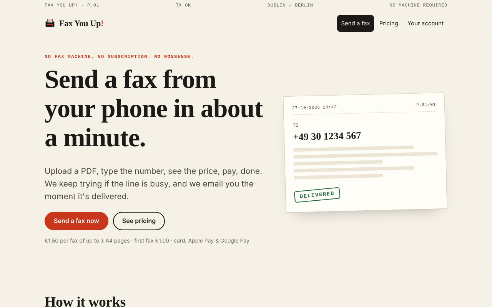
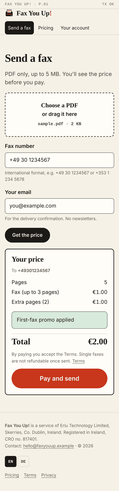
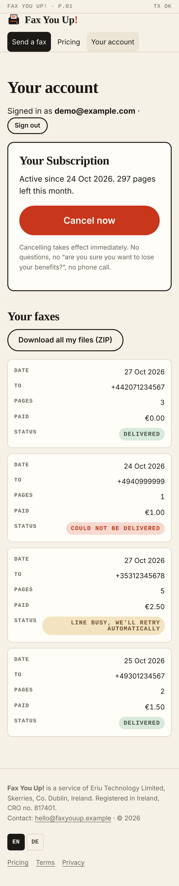
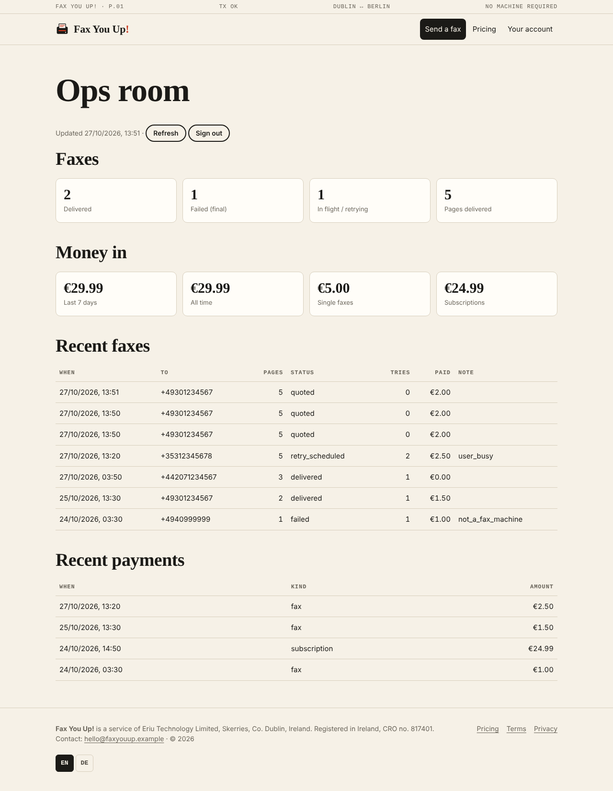
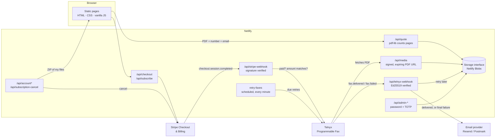
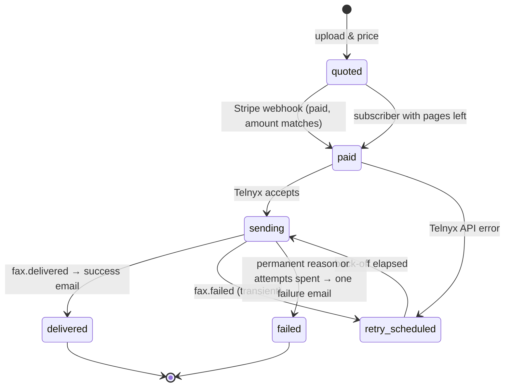

# Fax You Up!

> *Send a fax from your phone in about a minute. No machine, no subscription trap, no nonsense.*

<p align="center">
  
</p>

<p align="center">
  
  &nbsp;&nbsp;
  
</p>

<sub>Real screenshots of this repository running locally (`node scripts/preview-server.mjs`, with Stripe and Telnyx mocked), captured in headless Chromium at desktop and iPhone 13 sizes.</sub>

---

## A grudge, a fax, and a button the size of a barn door

There are still corners of officialdom, in Berlin and in Dublin alike, where the fax machine holds court like an elderly bishop who has simply refused to die. The Finanzamt wants a fax. The solicitor's office wants a fax. A hospital records department, somewhere, wants a fax and will accept no substitute, thank you very much.

So, some time ago, our founder did what any reasonable person does and paid an online fax service to send one. Grand. Then he cancelled. Grand again, or so you'd think. Except the service, with the serene indifference of a slot machine, went on charging him anyway. Month after month, the money trickled out like rain through a bad gutter.

Most people would write a stiff email. Niall O'Hara, being an IT man with a grievance and a free weekend, built a rival instead.

**Fax You Up!** is that rival. Its first principle is a lesson learned the hard way: *leaving should be easier than joining.* So the main product isn't a subscription at all. It's a single fax, priced before you pay, paid before it's sent. There *is* a monthly plan for the heavy faxers, and under **Your Subscription** sits a red button reading **Cancel now**, wide as a church door, that cancels the subscription in Stripe the moment you press it. No "are you sure you want to lose your benefits?", no retention offer, no phone number that rings out in a call centre the far side of the moon. One press, done, and here's a ZIP of every file you ever sent us, with our compliments.

Fax You Up! is run by **Eriu Technology Limited** (Skerries, Co. Dublin, Ireland) and aimed squarely at Berlin and Dublin.

## What it does

- **Upload, quote, pay, send.** Upload a PDF; the server counts its pages with `pdf-lib`, works out the price from one config file, and shows it to you *before* any money changes hands. Payment goes through Stripe Checkout; only once Stripe's signed webhook confirms the payment is the fax handed to Telnyx.
- **Card, Apple Pay and Google Pay, and nothing slow.** Checkout sessions are created with `payment_method_types: ['card']`. Apple Pay and Google Pay ride along on the card method (once switched on in your Stripe Dashboard). SEPA Direct Debit, Klarna and other methods that take days to settle are excluded, because a fax shouldn't sit in a queue waiting for a bank to make up its mind.
- **Automatic retries with exponential back-off.** Busy line, no answer, a machine out of paper: Fax You Up! tries again, waiting 2, then 8, then 32 minutes (four attempts in all, all configurable). Hopeless cases such as an invalid number or a line that isn't a fax machine are recognised and not retried at all.
- **One email, at the right moment.** You get a success email when the fax is delivered. You get a failure email **only** once failure is final, so the customer isn't pestered on every busy signal, and you get it exactly once even if Telnyx repeats its webhook.
- **First-fax promo.** Your first paid fax (per email address, case-insensitive, so SHOUTING doesn't earn you a second one) uses a lower base price. An unpaid quote doesn't use up the promo.
- **Optional monthly plan** with an allowance of pages; a signed-in subscriber with pages to spare sends without going through Checkout at all.
- **Passwordless accounts.** Sign in with a one-time link by email (valid 20 minutes). The account page lists your faxes, shows your subscription and the **Cancel now** button, and offers **Download all my files (ZIP)**: every PDF you've sent plus a `receipts.csv`.
- **Admin "ops room"** at an unlisted path (`/ops-room.html`), guarded by a password **and** a TOTP code from your authenticator app. It shows faxes delivered, failed, in flight and retrying, pages delivered, money in over the last 7 days and all time (split into single faxes and subscriptions), and the latest faxes and payments with their failure reasons. It's built to be read on an iPhone.

  
- **Built for phones first.** Readable at 390 pixels wide, with 16 px+ inputs so iOS Safari doesn't zoom, big tap targets (main buttons 48 px tall, the pay and cancel buttons 64 px), and the account table folding into cards on small screens.
- **Accessible and findable.** A skip link, labelled fields, `aria-live` status updates, visible focus rings, respect for `prefers-reduced-motion`, and a dark mode. For search engines, every page has a canonical URL, Open Graph tags and a meta description, and there's JSON-LD (`Organization`, `WebSite`, `FAQPage`, and a `Service` with `Offer`s on the pricing page), plus `sitemap.xml` and `robots.txt`.
- **English now, German waiting in the wings.** The navigation, the home page's hero and "How it works", the whole send flow and status view, the account controls and the footer carry `data-i18n` keys. `public/i18n/de.json` translates every one of them, and you switch language from the footer. (See [Roadmap](#roadmap) for what "planned language" still means.)
- **No third-party requests from the browser.** System fonts only, no analytics and no trackers. A strict Content-Security-Policy (`script-src 'self'`, `style-src 'self'`) is set in `netlify.toml`, and the link checker refuses any inline `style=""` that would break it.

## How pricing works

Every price lives in **one file**: [`config/pricing.js`](config/pricing.js). Amounts are in euro cents.

| Setting | Value | Meaning |
|---|---|---|
| `perFax.basePriceCents` | `150` | €1.50 for a fax of up to… |
| `perFax.includedPages` | `3` | …three A4 pages |
| `perFax.extraPageCents` | `50` | €0.50 for each page after that |
| `perFax.maxPages` | `50` | Larger documents are refused at quote time |
| `promo.firstFaxBasePriceCents` | `100` | €1 base price for a customer's first paid fax |
| `subscription.monthlyPriceCents` | `2499` | €24.99 a month… |
| `subscription.includedPagesPerMonth` | `300` | …for up to 300 pages |

So the arithmetic is simply:

```
total = (first paid fax ? promo base : base) + max(0, pages − includedPages) × extraPage
```

| Document | First fax | After that |
|---|---|---|
| 1–3 pages | €1.00 | €1.50 |
| 5 pages | €2.00 | €2.50 |
| 10 pages | €4.50 | €5.00 |

The browser never decides a price. `POST /api/quote` computes it and stores it on the fax record; `POST /api/checkout` charges Stripe exactly that stored amount; and the Stripe webhook refuses to send if the amount actually paid doesn't match. The pages fetch `/api/pricing` to fill in the figures they display, and a test (`tests/site.test.js`) fails the build if the fallback prices written into the HTML ever drift from the config file. That test checks the worked-examples table above, as it appears on the pricing page, too.

`allowedDestinationPrefixes` in the same file lists the countries we fax to. Telnyx charges by destination, and a flat price is only honest where it covers the cost.

**Refunds:** single faxes are not refundable once sent, because the line has been used. This is stated in plain words on the [Terms page](public/terms.html), on the quote box beside the **Pay and send** button, and in the FAQ.

## Architecture

A static site on Netlify, a small set of Netlify Functions, and two outside services doing the heavy lifting.



### The life of a fax



### Design choices worth a sentence each

- **Handlers are factories.** Every endpoint in `lib/handlers/` is `createXHandler(deps) → (Request) → Response`. The Netlify Functions in `netlify/functions/` are three-line wrappers that pass in the real dependencies (`lib/deps.js`); the tests pass in mocks. Nothing in the business logic imports Stripe or Telnyx directly.
- **Storage is an interface** (`getJSON`, `setJSON`, `getBytes`, `setBytes`, `delete`, `list`) with two drivers: Netlify Blobs (the default) and in-memory (for tests and the offline preview). Swapping in S3 or Postgres means writing one file.
- **Email is an interface** (`send({ to, subject, text, html })`) with Resend, Postmark, console and in-memory drivers, chosen by `EMAIL_PROVIDER`.
- **Telnyx fetches the PDF from us** through `/api/media?t=…`, an HMAC-signed URL that expires after 24 hours. The documents are never public.
- **Webhooks are idempotent.** A repeated Stripe event won't send a second fax; a repeated Telnyx event won't send a second email; a late event from a superseded attempt is ignored.
- **Retries run on a schedule.** Netlify Functions can't sleep for half an hour, so a failed attempt records `nextAttemptAt`, and the scheduled function `retry-faxes` (every minute) sends whatever is due.

## The honest-cancellation philosophy

A handful of rules, all enforced in code rather than merely promised in marketing:

1. **The main product isn't a subscription.** Pay per fax is the default everywhere: on the home page, on the send page and as the featured plan on the pricing page.
2. **Cancelling is one press.** `POST /api/subscription-cancel` calls `stripe.subscriptions.cancel()` straight away. There's no confirmation maze, and the endpoint doesn't hand off to a portal with its own retention screens.
3. **Pressing it twice is harmless.** The second press reports "already cancelled" and doesn't call Stripe again (this is tested).
4. **Cancelling in Stripe's own dashboard counts too.** `customer.subscription.deleted` is mirrored back to the account.
5. **You leave with your belongings.** The cancel response points to `/api/account-download`, a ZIP of every PDF you've sent plus a CSV of receipts, and the confirmation email says so too.
6. **No refunds on single faxes, said plainly and up front.** It's in the Terms, beside the pay button, and in the FAQ. Your statutory rights under Irish and EU law aren't affected.

## Setting it up

You'll need Node 18 or later, a Netlify account, a Stripe account and a Telnyx account. **Use test mode for everything until you're ready to go live.**

### 1. Install

```bash
git clone <your fork> fax-you-up && cd fax-you-up
npm install
cp .env.example .env
```

### 2. Stripe (test mode)

1. In the [Stripe Dashboard](https://dashboard.stripe.com/test/apikeys), with **Test mode** on, copy the secret key (`sk_test_…`) into `STRIPE_SECRET_KEY`.
2. **Settings → Payment methods:** turn on Cards, Apple Pay and Google Pay. The code only ever asks for `card`, so nothing else will show in Checkout even if you leave it switched on.
3. **Apple Pay:** nothing more to do. Checkout runs on Stripe's own domain, so you don't need to register a domain for Apple Pay (that's only for Stripe Elements on your own pages).
4. **Webhook:** add an endpoint at `https://<your-site>/api/stripe-webhook` listening for:
   - `checkout.session.completed`
   - `checkout.session.async_payment_succeeded`
   - `invoice.paid`
   - `customer.subscription.updated`
   - `customer.subscription.deleted`

   Copy its signing secret (`whsec_…`) into `STRIPE_WEBHOOK_SECRET`.
5. Products and prices are created on the fly from `config/pricing.js` (`price_data`), so there's nothing to set up in the catalogue.

Test card: `4242 4242 4242 4242`, any future expiry, any CVC.

### 3. Telnyx

1. In the [Telnyx portal](https://portal.telnyx.com), create an API key: `TELNYX_API_KEY`.
2. Create a **Fax Application** (Programmable Fax). Its ID is the `connection_id`: `TELNYX_CONNECTION_ID`. Set its webhook URL to `https://<your-site>/api/telnyx-webhook` (each fax also sends this URL explicitly).
3. Buy or port a number, assign it to that Fax Application, and put it in E.164 form in `TELNYX_FROM_NUMBER`.
4. **Keys & Credentials → Public Key:** copy the base64 Ed25519 key into `TELNYX_PUBLIC_KEY`. Incoming webhooks are verified against it using the `telnyx-signature-ed25519` and `telnyx-timestamp` headers, and anything older than five minutes is refused as a replay.

To test with real faxes cheaply, send to a fax-to-email test number, or to a second Telnyx number of your own that is set up to receive.

### 4. Email

Set `EMAIL_PROVIDER` to `resend` (with `RESEND_API_KEY`) or `postmark` (with `POSTMARK_SERVER_TOKEN`), and set `EMAIL_FROM` to an address on a domain you've verified with that provider. With `console`, emails are printed to the function log instead of being sent, which is handy locally.

### 5. Admin sign-in

```bash
npm run hash-password -- "a long passphrase you will not forget"
# → ADMIN_PASSWORD_HASH=scrypt$16384$8$1$…

npm run totp-setup
# → ADMIN_TOTP_SECRET=…  plus an otpauth:// URL for your authenticator app
```

Add the `otpauth://` URL to 1Password, Google Authenticator or similar (paste it in, or turn it into a QR code on your own machine). Then visit `/ops-room.html`.

### 6. Netlify

1. Create a site from the repository (or `netlify init`). `netlify.toml` already sets `public/` as the publish directory and `netlify/functions/` as the functions directory, and runs the link checker as the build command, so a broken link fails the deploy.
2. **Site configuration → Environment variables:** add every variable from `.env.example` that applies, with `SITE_URL` set to your live URL. Generate `SESSION_SECRET` with:
   ```bash
   node -e "console.log(require('crypto').randomBytes(32).toString('base64url'))"
   ```
3. Netlify Blobs needs no setup inside Netlify Functions.
4. Deploy. The scheduled `retry-faxes` function only runs on published deploys.

## Local development

### With `netlify dev` (the real stack)

```bash
npm install -g netlify-cli
netlify link            # once, to use the site's Blobs store and env vars
netlify dev             # http://localhost:8888
```

In a second terminal, forward Stripe webhooks to your machine:

```bash
stripe listen --forward-to localhost:8888/api/stripe-webhook
# paste the whsec_… it prints into .env as STRIPE_WEBHOOK_SECRET
```

Telnyx needs a public URL to reach you, so use `netlify dev --live` or a tunnel and point the Fax Application's webhook at it. While experimenting you may set `TELNYX_SKIP_SIGNATURE_VERIFICATION=true`; the code ignores it when `CONTEXT=production`.

To trigger the retry runner by hand: `netlify functions:invoke retry-faxes`.

### Offline preview (no accounts, no keys)

```bash
node scripts/preview-server.mjs   # http://localhost:8899
```

This serves `public/` and runs the **same handler code** against in-memory storage, a mocked Stripe and a mocked Telnyx. It's seeded with a demo subscriber (`demo@example.com`), whose sign-in link is printed in the terminal when you ask for one. It also prints throwaway admin credentials and a current TOTP code, so you can wander the whole site, including the ops room. It's how the screenshots above were taken. "Paying" simply loops back to the send page, and nothing is ever faxed.

## Tests

```bash
npm test             # node:test, no network, Stripe & Telnyx mocked
npm run check:links  # HTML sanity check
npm run check        # both
```

**53 tests, all passing**, on Node's built-in test runner. Stripe signature verification uses the real `stripe` library against a test secret; only the network calls are mocked. The Telnyx Ed25519 signatures are made with a freshly generated key pair.

| File | What it proves |
|---|---|
| `tests/pricing.test.js` | Quote arithmetic, extra pages, limits, configurability, real PDF page counting, non-PDF rejection, fax-number normalisation and allowed countries |
| `tests/promo.test.js` | First-fax promo applies once per email (case-insensitive), survives an unpaid quote, can be switched off |
| `tests/webhooks.test.js` | Stripe webhooks rejected with no signature, the wrong secret, or a tampered body; Telnyx webhooks rejected when forged, unsigned or replayed; the skip flag is ignored in production |
| `tests/send-flow.test.js` | Checkout asks Stripe for exactly the quoted amount, card only; a paid webhook sends exactly one fax (duplicates ignored); unpaid or wrong-amount sessions send nothing; the signed media URL works and forged ones don't |
| `tests/retry.test.js` | Back-off schedule and cap; transient vs permanent failures; full retry cycle with **no** customer email until the final failure and **exactly one** after; fail-then-deliver sends only the success email; stale attempts ignored; Telnyx API errors go through the same policy |
| `tests/account.test.js` | Subscribe session; **one-press cancel** calls Stripe once and is idempotent; cancel requires a valid session; Stripe-side cancellation mirrored; ZIP contains every PDF plus `receipts.csv`; subscribers send without Checkout; magic-link round trip |
| `tests/totp.test.js` | TOTP against the RFC 6238 test vectors, HOTP against RFC 4226, drift window, admin login requires password **and** code, stats locked without a session |
| `tests/site.test.js` | Prices written into the HTML match `config/pricing.js`; the worked examples are right; Terms state the no-refund and cancel rules; the link checker passes |

`scripts/check-links.mjs` checks every page in `public/`: internal links and assets exist, `/api/…` links point to real functions, in-page anchors resolve, every page has a title, a description, `lang`, a viewport tag and exactly one `<h1>`, images carry `alt`, there are no inline styles, every `data-i18n` key exists, the German file has every English key, and every URL in the sitemap exists. GitHub Actions (`.github/workflows/ci.yml`) runs the lot on Node 18, 20 and 22.

## Roadmap

> **Everything in this section is planned, not built.** If it's listed here, the repository doesn't do it yet.

- **Multilingual site: English, German, Spanish and Brazilian Portuguese.** Today the German strings exist (`public/i18n/de.json`) and the footer switch swaps them in on the client, but the Terms, Privacy and FAQ text, the emails and the server's error messages are English only, and there are no per-language URLs for search engines yet. Spanish and Portuguese aren't started.
- **PayPal** as a payment option alongside Stripe.
- **Your own fax number:** a dedicated Berlin or Dublin number per customer, including receiving faxes.
- **Cover-page options** (Urgent, Confidential, Please Respond), and a paid **encrypted** option. How that would work end to end for a machine on the other side is still to be worked out.
- **Payment and sent-fax receipts as PDFs**, plus more columns on the admin payouts table.
- **Sign in with Google, Apple or phone number**, as well as email links.
- **Rate limiting** on the quote and sign-in endpoints, beyond what Netlify provides.

## Project layout

```
fax-you-up/
├── config/
│   ├── pricing.js            ← every price, in one place
│   └── retry.js              ← attempts, back-off, permanent-failure reasons
├── lib/
│   ├── pricing.js            quote maths, PDF page count, number validation
│   ├── retry.js              back-off and the retry / give-up decision
│   ├── faxes.js              fax life cycle, send attempt, notifications, retry runner
│   ├── telnyx.js             minimal Telnyx Programmable Fax client
│   ├── totp.js               RFC 6238 TOTP (no dependencies)
│   ├── crypto.js             scrypt passwords, signed tokens, Telnyx Ed25519 check
│   ├── session.js            customer & admin cookies
│   ├── http.js               small Response helpers
│   ├── deps.js               wires real Stripe / Telnyx / storage / email from env
│   ├── storage/              interface + Netlify Blobs and in-memory drivers
│   ├── email/                interface + Resend, Postmark, console, memory; templates
│   └── handlers/             public, payments, telnyx-webhook, account, admin
├── netlify/functions/        one thin wrapper per route + scheduled retry-faxes
├── public/                   the static site (8 pages, CSS, JS, i18n, sitemap, robots)
├── scripts/
│   ├── check-links.mjs       HTML / i18n / sitemap sanity check
│   ├── preview-server.mjs    offline preview with mocked Stripe & Telnyx
│   ├── hash-password.mjs     makes ADMIN_PASSWORD_HASH
│   └── totp-setup.mjs        makes ADMIN_TOTP_SECRET + otpauth URL
├── tests/                    node:test suites (53 tests)
├── docs/                     screenshots
├── .env.example              every environment variable, documented
├── netlify.toml              build, functions, security headers
└── LICENSE
```

## Licence

The code is released under the [MIT Licence](LICENSE), © 2026 Niall O'Hara. Fork it, learn from it, build your own fax empire.

The **name "Fax You Up!", its logo and its branding are not covered by that licence**, so if you run your own copy, please christen it something else.
